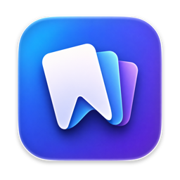
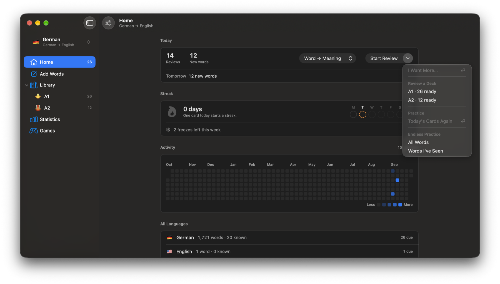
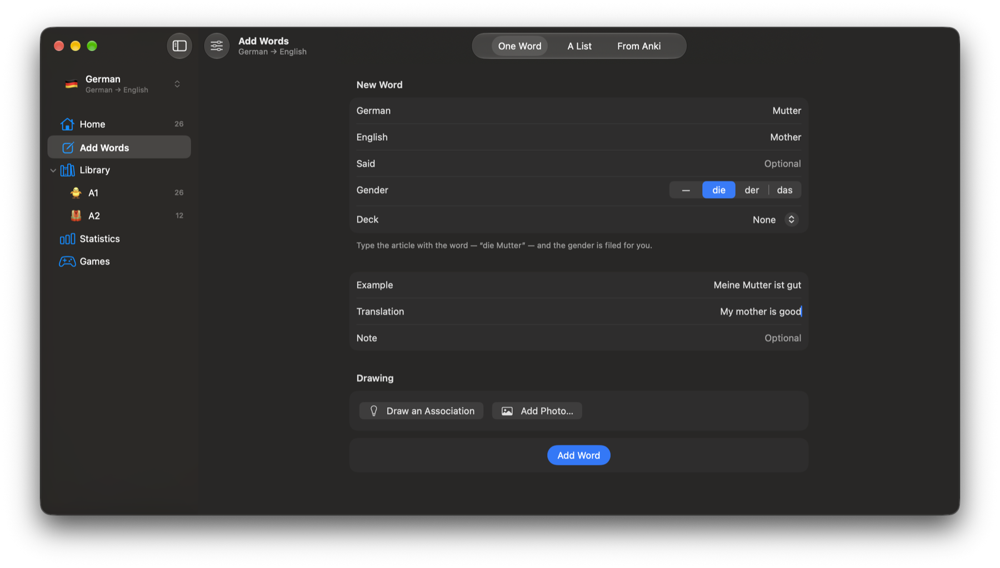
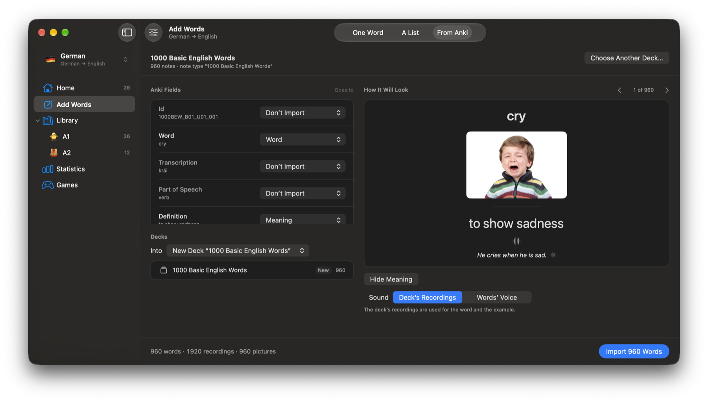
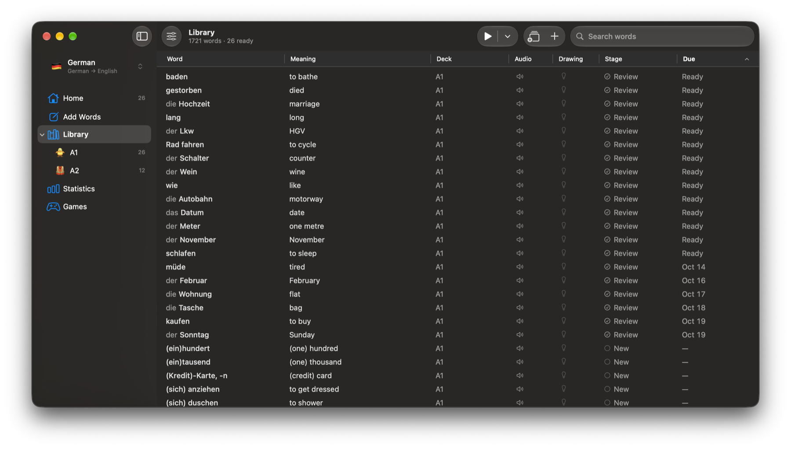
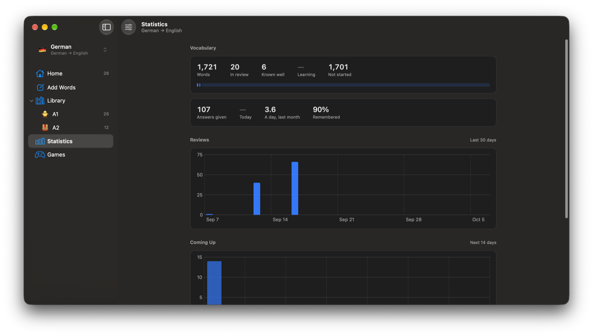
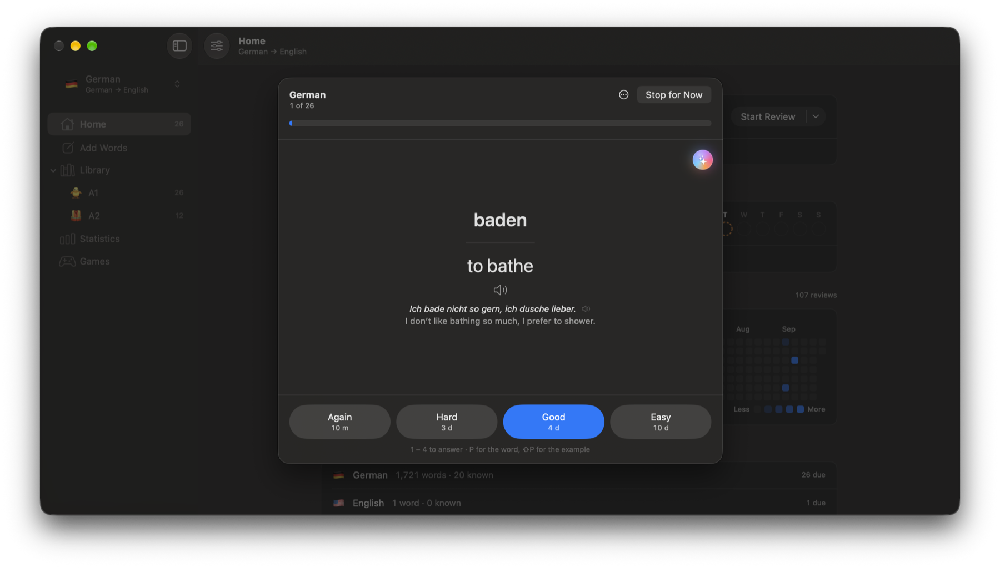
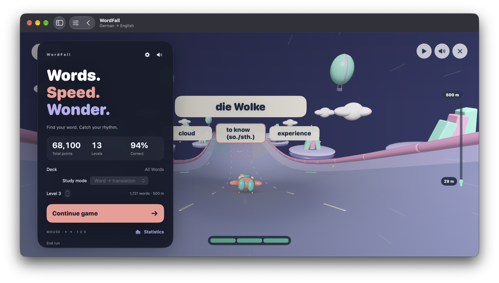
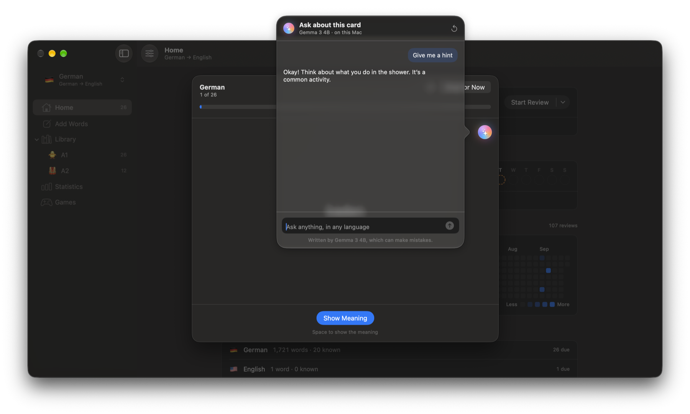
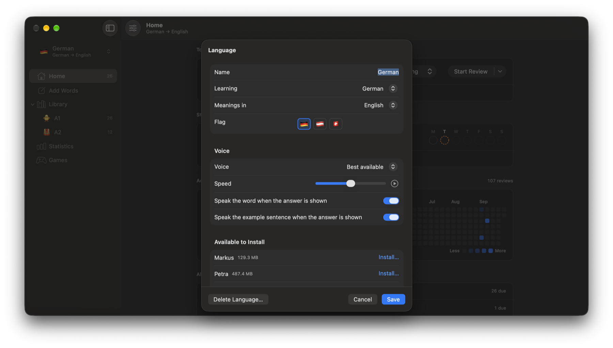

<div align="center">
  

  # Words

  **A little practice. A growing vocabulary.**

  A native macOS app for learning words — with spaced repetition, your own decks, and an on-device AI companion.

  No account. No server. Your vocabulary stays on your Mac.

  [Download](https://github.com/Ta2-me2/Words/releases/latest) · [Install](#install) · [Build from source](#building) · [Report an issue](https://github.com/Ta2-me2/Words/issues)

  [](https://github.com/Ta2-me2/Words/actions/workflows/checks.yml)
</div>

---

## About

Words gives the vocabulary you collect a place to grow. Add a word, bring in a list, or import an Anki deck, then learn through daily reviews, examples, audio, and visual associations.

Reviews use **FSRS** — the Free Spaced Repetition Scheduler, the one Anki ships — written out in this project rather than imported, so two words learned on the same afternoon can end up months apart. Alongside your cards, a local AI companion helps explain unfamiliar words and grammar, while **WordFall** and **Dictation** turn your own vocabulary into games.

> Built with SwiftUI for Apple silicon Macs. The library is one JSON file and a folder of media on your own disk, and the model that answers questions about a card runs on the same Mac.

---

## Features

### Home

Your daily learning at a glance. See the reviews and new words waiting for you, choose a study direction, and start a session. A streak tracker and activity calendar help you follow your routine, with an overview of all your languages below.

- Set daily limits for new words and reviews, with separate limits for individual decks.
- Choose the days you want to study and use streak freezes when life gets busy.
- Ready for another round? **I want more** adds to today's allowance without changing your usual limits.

<p align="center">
  
</p>

### Add Words

Four ways in: one word at a time, a whole list pasted, an Anki `.apkg` deck, or a `.wordspack` another copy of Words exported. Only the word and its meaning are required; add pronunciation notes, gender, an example sentence, its translation, and a personal note whenever they help.

- The one-word side is an empty card rather than a form: every field stands where the finished card puts it, and Tab moves from one to the next.
- Type an article with a word, such as **die Mutter**, and Words files the gender.
- Ask the companion to write the example sentence and its translation, then read it over before the word goes in — in the single-word editor and in every row of a pasted list.
- Attach a photo or draw an association with PencilKit to make a word more memorable.
- Paste lists with flexible formatting — blank lines, Markdown bullets, tabs, a dash where a semicolon should be — or copy the included prompt to have an AI prepare one for you.

<p align="center">
  
</p>

The Anki importer reads the messes real shared decks arrive in: it guesses which field is the word, which the meaning, which the article, and lines recordings and pictures up with the notes they belong to.

<p align="center">
  
</p>

### Library

A home for every word you collect. Organize your vocabulary into decks and subdecks, give them their own icons, and search your library as it grows. See each word's meaning, deck, audio, visual association, learning stage, and next review date in one table. A word with no example can be given one by the companion — the Library writes them in a run, oldest first, and nothing is saved until you have read it.

<p align="center">
  
</p>

### Statistics

See how your vocabulary is developing: words you have not started, words you are learning, and words you know well. Follow your review activity, recall rate, and daily average, then look ahead at the reviews coming up.

It also checks the schedule itself: the share of words you meant to remember against the share that actually came back, grouped by how long each had waited. If the two disagree, one setting puts it right.

<p align="center">
  
</p>

### Review & Practice

Learn in either direction — word → meaning, meaning → word, or a mix of both. Reveal the answer, listen to the word and its example, then rate your recall with Again, Hard, Good, or Easy. FSRS uses your response to schedule the next review.

For extra repetition, switch to practice without changing your review schedule, using today's cards or an endless session. Keyboard shortcuts keep reviews moving: Space reveals the meaning, 1–4 rates your answer, and P plays the word.

<p align="center">
  
</p>

### Games

Both games are played with the language's own words, and neither touches your schedule.

- **Dictation** — a phrase is read aloud and you type it back; all you see is its shape, one first letter per word. It plays your words, the examples kept with them, or sentences you write yourself, and a word with no example can be given one by the companion without leaving the game. Marked word by word, with a dropped accent told apart from a word got wrong, and a daily goal of its own.
- **WordFall** — a RealityKit vocabulary game built around your own decks. Choose a deck and study direction, find the right meaning as you play, and follow your points, levels, and accuracy.

<p align="center">
  
</p>

### Local AI Companion

The small sphere beside a card opens a conversation about the word you are learning. Ask for a hint, explore an example sentence, or get help with grammar in your preferred language. The companion receives the card's context, your language pair, and whether the answer has been revealed, so it can offer a hint while you are still trying to remember.

Choose a model in Settings:

- **Apple Intelligence** — uses the built-in model on a supported Mac, with no separate model download. It does not speak Russian yet.
- **Gemma 3 4B** — an optional download of approximately 3 GB, running locally through [MLX](https://github.com/ml-explore/mlx-swift-lm), with multilingual support and the ability to read a card's picture.

Conversations are processed on your Mac. Installing Gemma downloads the model from Hugging Face and requires accepting Google's [Gemma Terms of Use](https://ai.google.dev/gemma/terms).

<p align="center">
  
</p>

### Languages & Voices

Thirty-one languages to learn, nineteen of which have gender rules written for them — and if yours is not among them, add it yourself with its own name and flag. Keep separate language pairs, choose the language you want meanings in, pick an available macOS voice, adjust its speed, and decide whether words and examples play automatically when an answer appears.

Gender is kept as a gender rather than as an article, so the same word is marked the way each language marks it: German says *die Mutter* out loud, Russian prints *жен.* beside the entry and reads neither aloud.

Use your own recordings, or write a transcription the way you write sounds down, for the languages no system voice will ever read — Georgian is in the list, and macOS has no voice for it. Additional macOS voices can be installed from the language settings.

<p align="center">
  
</p>

### Export

Export is its own section. Tick whole languages, a deck, or one subdeck; leave behind the photographs, the recordings, the drawings or your own schedule; and write it all into one `.wordspack` — a plain zip with readable JSON and a media folder, which another copy of Words opens with the decks exactly as they were.

Importing only ever adds: a word already in the language is left as it is, and nothing you have studied is overwritten.

---

## Your Data

Your library is stored locally as a JSON file with folders for media, game progress, and any companion model you install:

```text
~/Library/Application Support/Words/
├── Library.json    Languages, decks, words, and review history
├── Media/          Recordings, photographs, and drawings
├── Games/          Game progress
└── Models/         Downloaded companion model
```

No account or hosted backend is required. Your vocabulary and companion conversations stay on your Mac; optional model and voice downloads require an internet connection.

---

## Install

Download the `.dmg` from [Releases](https://github.com/Ta2-me2/Words/releases/latest), open it, and drag **Words** to **Applications**.

The first launch needs one extra step. The app is signed ad hoc, not with a paid Apple Developer certificate, so macOS will not open it straight away:

1. Open **System Settings ▸ Privacy & Security**.
2. Scroll down to the line saying Words was blocked, and click **Open Anyway**.
3. Confirm. macOS remembers the decision; every later launch is ordinary.

If macOS says instead that the app **is damaged and should be moved to the Trash**, that is the quarantine flag on a download it cannot check. Remove it from your installed copy:

```bash
xattr -dr com.apple.quarantine /Applications/Words.app
```

Only run that on a copy downloaded from this project's releases. If you would rather not take anyone's word for what you are running, [build it yourself](#building) — it is three commands, and nothing in it needs an account.

## Requirements

- **macOS 26 or later** for the app.
- **macOS 27** for the local AI companion.
- A Mac with **Apple silicon**.
- **Xcode 27 with Swift 6.4** to build from source.

## Building

```bash
git clone https://github.com/Ta2-me2/Words.git
cd Words
open Words.xcodeproj
```

Build and run from Xcode. The first build resolves the Swift packages and asks you to trust MLX's build plugins — choose **Trust & Enable**.

<details>
<summary><strong>Command-line build &amp; troubleshooting</strong></summary>

Build from Terminal:

```bash
xcodebuild -project Words.xcodeproj -scheme Words -configuration Debug \
  -derivedDataPath build -skipPackagePluginValidation -skipMacroValidation build
```

MLX compiles Metal kernels. If the build stops at `cannot execute tool 'metal'`, install the toolchain:

```bash
xcodebuild -downloadComponent MetalToolchain
```

To build the disk image a release page carries:

```bash
Scripts/make-dmg.sh
```

The app is signed ad hoc and is not sandboxed. No Apple Developer account is needed to build or run it locally.

</details>

### Checks

```bash
Tests/run.sh
```

1480 checks over the scheduler, the queue, the day's allowance, decks and subdecks, the import formats, the Anki reader, the streak, the store, the export package, the dictation marking, what each of the thirty-one languages does with gender, and what the companion is told. They compile as a command-line binary, so they run in a couple of seconds and need no window.

For the project structure and the decisions behind it, see [ARCHITECTURE.md](ARCHITECTURE.md).

---

## Built With

SwiftUI · FSRS · RealityKit · PencilKit · Apple Intelligence · [MLX](https://github.com/ml-explore/mlx-swift-lm)

---

<div align="center">
  Made with care by <a href="https://github.com/Ta2-me2">Daniil Lavrov</a>

  MIT License — see <a href="LICENSE">LICENSE</a>. The packages under <code>Packages/</code> are covered by the same licence; the models and libraries Words downloads are each under their own.
</div>
